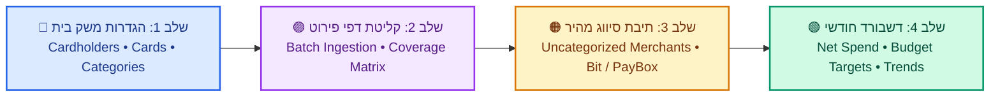

# ₪ ניהול הוצאות משק בית (Household Expense Management)

מערכת לניהול, קליטה וניתוח הוצאות כרטיסי אשראי (Isracard / American Express) למשק בית.

---

## 🧭 מדריך התמצאות לפי 4 שלבי עבודה



| שלב | מסך במערכת | פעולות מרכזיות |
| :---: | :--- | :--- |
| 🔵 **שלב 1** | **הגדרות משק בית** | • עדכון שמות בני הזוג (`Cardholders`)<br/>• הגדרת 4 ספרות אחרונות לכרטיסים (`Cards`)<br/>• קביעת קטלוג קטגוריות ויעדי תקציב חודשיים (`Budget Targets`) |
| 🟣 **שלב 2** | **כיסוי דפי פירוט** | • גרירת קובצי אקסל/CSV של ישראכרט ואמקס (.xls, .xlsx, .csv)<br/>• קליטה אוטומטית ובדיקת חוסרים במטריצת חודש × כרטיס<br/>• שיוך כרטיס חדש בלחיצה אחת במידת הצורך |
| 🟠 **שלב 3** | **תיבת סיווג** | • סיווג מהיר לבתי עסק שטרם סווגו (חיובי עבר ועתיד נצבעים מיידית)<br/>• עיון בחיובי Bit / PayBox מרובי עסקאות<br/>• מיזוג שמות בתי עסק דומים (`Merge Merchants`) |
| 🟢 **שלב 4** | **דשבורד חודשי** | • תמונת הוצאות נטו (בניכוי זיכויים אוטומטי)<br/>• מעקב עמידה ביעדי תקציב ואזהרות חריגה<br/>• השוואה לממוצע חודשים קודמים ותחזית התחייבויות תשלומים קדימה |

---

## ⚡ התחלה מהירה (Quick Start)

### דרישות קדם
- **Node.js** `>= 20.0.0` (מומלץ Node 24)
- **pnpm** `>= 10.0.0`

### הרצה מקומית ב-3 צעדים:

```bash
# 1. התקנת תלויות
pnpm install

# 2. הידור החבילות המשותפות והאפליקציות
pnpm build

# 3. הפעלת שרת פיתוח (UI + API במקביל)
pnpm dev
```

- **ממשק משתמש (Web UI)**: [http://localhost:5173](http://localhost:5173)
- **שרת נתונים (REST API)**: [http://localhost:3001](http://localhost:3001)
- **בדיקת תקינות (Health)**: [http://localhost:3001/api/health](http://localhost:3001/api/health)

---

## 🧪 בדיקות ואיכות קוד

```bash
# הרצת כל הבדיקות (Vitest)
pnpm test

# בדיקת טיפוסי TypeScript מחמירה
pnpm typecheck

# בדיקת סגנון קוד (ESLint)
pnpm lint

# איפוס נתונים מלא להתחלה מאפס (ריקון עסקאות, כרטיסים ובתי עסק)
pnpm db:reset
```

---

## 🏛️ מבנה המערכת (Monorepo)

- [`apps/web`](file:///home/netancoh/Desktop/MyProjects/bills-management/apps/web) – ממשק React 19 + Tailwind CSS בעברית מלאה (RTL).
- [`apps/api`](file:///home/netancoh/Desktop/MyProjects/bills-management/apps/api) – שרת Fastify v5, מנוע קליטת קבצים, SQLite repository.
- [`packages/domain`](file:///home/netancoh/Desktop/MyProjects/bills-management/packages/domain) – לוגיקה עסקית טהורה: נירמול בתי עסק, ניתוח נטו, פריסת תשלומים.
- [`packages/shared`](file:///home/netancoh/Desktop/MyProjects/bills-management/packages/shared) – סכמות Zod משותפות ו-DTOs.
- [`packages/db`](file:///home/netancoh/Desktop/MyProjects/bills-management/packages/db) – סכמת SQLite ו-Drizzle ORM.

---

## 📖 מילון מונחים מרכזי

לפירוט המלא ראו [GLOSSARY.md](file:///home/netancoh/Desktop/MyProjects/bills-management/GLOSSARY.md):

| מונח באנגלית | מונח בעברית | הסבר קצר |
| :--- | :--- | :--- |
| **Cardholder** | מחזיק כרטיס | בן/בת הזוג במשק הבית המחזיקים בכרטיס. |
| **Card** | כרטיס אשראי | כרטיס המשויך למחזיק, מזוהה לפי 4 ספרות אחרונות. |
| **Statement** | דף פירוט | קובץ פירוט חודשי מישראכרט או אמריקן אקספרס. |
| **Billing Month** | חודש חיוב | חודש החיוב בבנק (`YYYY-MM`) שלפיו מחושבות ההוצאות. |
| **Spending Nature** | אופי הוצאה | סיווג על: קבועות (`Fixed`), מחיה משתנות (`Variable`), פינוקים (`Discretionary`). |
| **Budget Target** | יעד תקציב | תקרת הוצאה חודשית בש"ח לקטגוריה. |
| **Excluded** | עסקה מוחרגת | עסקה שאינה נכללת בסיכומי ההוצאה (כגון החזר הוצאות עבודה). |
